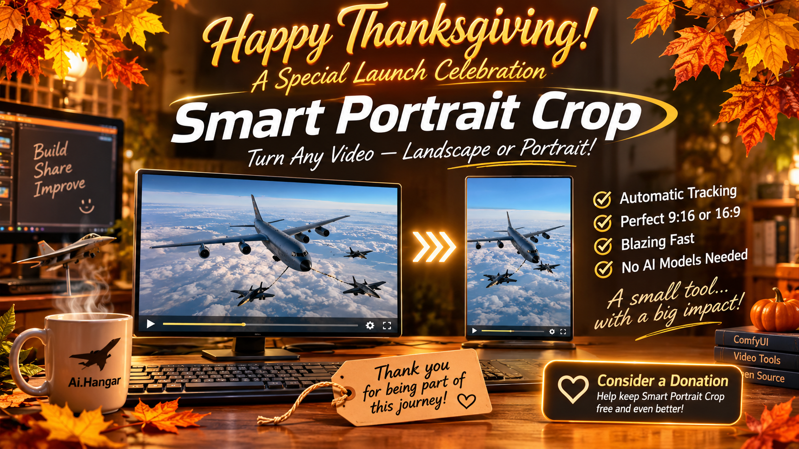

# Smart Portrait Crop

Turn any video, landscape or portrait, into an intelligently tracked 9:16 or 16:9 crop, with a virtual camera that keeps the action in frame. Automatic tracking, blazing fast, and no AI models needed for most modes.

https://github.com/user-attachments/assets/f87454ba-3b26-425d-bc41-54364fc16590

## Choose Your Version

Smart Portrait Crop comes in two flavors. Pick the one that fits how you work.

### 🧩 ComfyUI Version

**For:** ComfyUI users who want cropping built into their workflows.

A custom node plus a ready-made workflow. Connect your video, and it tracks the subject and crops to 9:16 (or 16:9, or any size you like), so it can sit in the middle of a larger pipeline alongside your other nodes.

👉 **[Get the ComfyUI version](https://github.com/aihangar111/comfyui-smart-portrait-crop)** (this repo), or jump to the [full ComfyUI guide](#comfyui-version-full-guide) below.

### ⚡ Stand-alone Version (Windows, no ComfyUI)

**For:** Everyone else, with no ComfyUI required.

A small download with a double-click launcher. The script itself is only 8.01 KB, small enough to read in one sitting. Drop a video on it and get a tracked, cropped result with the original audio kept. The first run installs a few helper packages, so it needs internet once (details in the guide below).

👉 **[Download the stand-alone version (SmartPortraitCrop.zip)](https://github.com/aihangar111/comfyui-smart-portrait-crop/raw/main/SmartPortraitCrop.zip)**, or jump to the [stand-alone guide](#stand-alone-version-guide) below.

## What It Does

- **Automatic tracking:** a virtual camera follows the subject so it stays in frame
- **Perfect 9:16 or 16:9:** works with landscape or portrait source video, and any other output size
- **Blazing fast:** it analyzes small thumbnails and does the crop on the GPU
- **No AI models needed for most modes:** the optional YOLO detector modes are the only ones that use a model file (see [What You May Need to Download](#what-you-may-need-to-download))

---

# ComfyUI Version: Full Guide

Turn any landscape video into a vertical 9:16 video for Instagram Reels, YouTube Shorts and TikTok, with a virtual camera that keeps the action in frame. It also works the other way (9:16 to 16:9) and for any other output size.

It is a single custom node plus a ready-made workflow. It is fast (it analyzes small thumbnails and does the crop on the GPU), it needs no extra models for most modes, and it gives you several ways to decide where the camera looks, from fully automatic to fully manual.

It was built around an aerial refueling animation created in ComfyUi (a fixed camera in a boom operator pod looking at a large receiver aircraft), so it handles big subjects, fixed cameras and static window frames well. It also works on people and faces.

> **Status:** this is a hobby project, not a polished release. Tracking quality depends on your footage. When auto-tracking misses, `manual` mode with keyframes is the reliable fallback.

## What the node does

- Crops a 9:16 window out of a landscape frame and slides it left and right to follow the subject.
- Smooths the camera so it doesn't jitter: it holds still until the subject leaves a safe zone, then moves without lag.
- Detects scene cuts and re-centers instead of panning across the cut.
- Optionally keeps the **whole landscape frame** visible over a blurred, dimmed background, so wide subjects aren't cropped.
- Exports to H.264 MP4 with the original audio and frame rate.

## Install

1. **ComfyUI-VideoHelperSuite** (VHS) is required for the video load and export nodes. Install it through ComfyUI Manager.
2. Install the node, using any one of these:
   - **ComfyUI Manager**: search for "Smart Portrait Crop" and install it.
   - **Comfy CLI:** run `comfy node install smart-portrait-crop`.
   - **Manually:** clone this repo into `ComfyUI/custom_nodes/` (`git clone https://github.com/aihangar111/comfyui-smart-portrait-crop`), or copy `smart_portrait_crop.py` alone into `ComfyUI/custom_nodes/`.
3. **Restart ComfyUI and refresh the browser tab.** The node's Python file is only read at startup, so a new version needs a restart. If a node already on your canvas looks old, delete it and add it again from the search box ("Smart Portrait Crop").
4. Load `example_workflows/portrait_9x16_workflow.json` (drag it onto the canvas) and choose your video in the loader node. If your video has no sound, load `example_workflows/portrait_9x16_workflow_no_audio.json` instead.

### What You May Need to Download

Most modes need no model at all. These are the extra files involved:

- **ComfyUI-VideoHelperSuite** (required): provides the video load and export nodes.
- **`ultralytics` Python package** (optional, detector modes only).
- **A YOLO weights file** (optional, detector modes only), such as `yolov8n.pt` (people, aircraft, vehicles and about 80 other COCO classes) or a face model like `face_yolov8n.pt`. Put it in `ComfyUI/models/ultralytics/` (the `bbox` and `segm` subfolders also work), or give a full path in `yolo_model`.

> **License note:** Ultralytics YOLO is AGPL-3.0. Check that it suits your use, especially commercial use.

## The workflow

```
Load Video (VHS) -> Smart Portrait Crop (9:16) -> Video Combine (H.264 MP4)
        |                                                ^
        +--- audio ------------------------------------+
        +--- Meta Batch Manager (processes in 120-frame chunks) ---+
```

The Meta Batch Manager keeps memory use low on long clips. The node remembers the camera position between chunks, so there are no jumps at the boundaries.

## Tracking modes

Pick the mode with the `tracking` setting.

| Mode | What it does | Best for |
|---|---|---|
| `manual` | You set where the camera is, using keyframes. | Anything where you know where the action is. The most reliable mode. |
| `yolo_detect` | A YOLO detector finds the chosen class (`person`, `airplane`, ...) and the camera follows it. Frames with no detection keep the last position. | People, aircraft and vehicles that a COCO model recognizes. |
| `face_yolo` | The same as `yolo_detect`, intended for face models. | Interviews, talking heads. |
| `aircraft` | No model needed. Finds large objects that stand out from smooth sky, using local contrast, then sticks to one object. | Aircraft against sky. Can wander on big flat surfaces or when the subject stops moving. |
| `auto_saliency` | Follows motion and detail, with a gentle pull toward the center. No model needed. | General footage, for example a person moving through a scene. |
| `use_mask` | Follows a mask you connect to the `masks` input (from SAM, Florence2, Grounding DINO and similar). Falls back to automatic on frames with an empty mask. | Following one specific subject precisely. |

`target_class` only applies to `yolo_detect` and `face_yolo`. It is ignored in every other mode.

## Settings

### Output
| Setting | Default | Notes |
|---|---|---|
| `out_width` / `out_height` | 1080 / 1920 | Output size. Any size works, for example `1920` x `1080` for landscape. |
| `fit_mode` | `crop_to_fill` | `crop_to_fill` fills the whole output frame. `blurred_background` shows the full source frame in the middle over a dimmed, blurred copy of itself, so nothing is cropped away. |

**Other aspect ratios and the reverse direction.** The output size is up to you: `1920` x `1080` gives landscape 16:9, `1080` x `1080` gives square, and so on. The node slides the crop window along whichever axis has room, so a landscape source going to portrait follows left and right, and a **portrait (9:16) source going to landscape (16:9) follows up and down**. In that case the horizontal "x" values below mean vertical position (0 = top, 1 = bottom), and `x_offset`, `camera_min_x`, `camera_max_x`, `hold_x` and the keyframes work the same way along that axis. Keep in mind that a 9:16 source cropped to 16:9 keeps only about a third of its height. `blurred_background` is usually the better choice for that direction, since it keeps the whole portrait video visible with blurred sides. If source and output have the same aspect ratio, the node simply rescales.

### Camera behavior
| Setting | Default | Notes |
|---|---|---|
| `smoothing` | 0.85 | Higher is a steadier, slower camera. |
| `deadzone` | 0.12 | How far the subject can drift (as a fraction of the crop width) before the camera moves. |
| `scene_cut_sensitivity` | 0.35 | Lower detects more cuts. |
| `x_offset` | 0.0 | Shifts the final camera left (-) or right (+), as a fraction of video width. Works in every mode. |
| `camera_min_x` / `camera_max_x` | 0.0 / 1.0 | Guard rail. The camera center never leaves this range (0 = left edge, 1 = right edge). Works in every mode. |
| `hold_from_frame` | -1 (off) | From this frame on, freeze the camera, with a half-second ease. |
| `hold_x` | -1 | Where to freeze (0 to 1). -1 freezes exactly where the camera was at `hold_from_frame`. |

### Manual mode
`camera_keyframes` takes `frame:x` pairs, where x runs from 0 (left edge) to 1 (right edge). The camera glides between them.

```
0:0.35, 240:0.5, 600:0.65
```

To find a frame number, multiply the time in seconds by the frame rate (frame 300 is 10 seconds in at 30 fps).

### Detector modes
| Setting | Default | Notes |
|---|---|---|
| `yolo_model` | `face_yolov8n.pt` | File name or full path. |
| `target_class` | `(any)` | Drop-down: `person`, `airplane`, `person + airplane`, `face`, and the rest of the COCO classes. Must exist in the model you chose. |
| `detect_conf` | 0.25 | Lower it if detections are missing. Raise it for fewer false hits. |
| `face_select` | `largest` | Follow the `largest` detection, the `most_confident` one, or center on `all_faces` (a group). Applies to any class. |

### Aircraft / auto modes
| Setting | Default | Notes |
|---|---|---|
| `ignore_static` | 0.8 | Down-weights parts of the picture that never change (window frame, cockpit, pod interior). Lower it (about 0.3) if the subject stops moving and the node loses it. |
| `motion_weight` | 1.0 | How much movement counts. |
| `detail_weight` | 0.6 | How much edges and texture count. |
| `center_bias` | 0.25 | Pull toward the center (`auto_saliency` only). |

### Outputs
- `images`: the 9:16 frames.
- `camera_path_info`: text listing the source and output size, frame count, scene cuts, detection count (detector modes) and where the camera sat every few frames. Connect it to a text preview node to see what the tracker did.

## Recipes

**Fixed camera, big subject, you know where it is** (for example a boom pod view)
`tracking = manual`, `camera_keyframes = 0:0.58` (adjust to taste), `fit_mode = blurred_background` if you want the whole scene visible.

**Follow an aircraft automatically, then lock when it settles**
`tracking = yolo_detect`, `target_class = airplane`, `hold_from_frame` = the frame where the action settles, and `camera_min_x` / `camera_max_x` to keep the camera in a sensible range.

**One person or a group**
`tracking = yolo_detect`, `yolo_model = yolov8n.pt`, `target_class = person`, `face_select = largest` (or `all_faces`).

**Talking head**
`tracking = yolo_detect` or `face_yolo`, `yolo_model = face_yolov8n.pt`, `target_class = face`.

**Subject too wide for a vertical crop**
`fit_mode = blurred_background`.

**Portrait video to landscape (9:16 to 16:9)**
`out_width = 1920`, `out_height = 1080`, and `fit_mode = blurred_background` to keep the whole picture, or `crop_to_fill` to crop a strip that follows the subject up and down.

## Troubleshooting

- **The camera pans away at a key moment.** Add a guard rail (`camera_min_x`, `camera_max_x`), freeze it with `hold_from_frame`, or switch to `manual`. This usually happens when a large subject is cut off by the frame edge and its detected center shifts.
- **A detector finds nothing.** Check the detection count in `camera_path_info`. Lower `detect_conf`, and confirm `target_class` is a class the model knows. A face model only knows `face`.
- **The camera is twitchy.** Raise `smoothing` or `deadzone`.
- **The camera reacts too slowly.** Lower `smoothing` or `deadzone`.
- **New settings don't appear after an update.** Restart ComfyUI, refresh the browser, and re-add the node.
- **The run fails with "VHS failed to extract audio" (or "audio not found").** The source video has no sound track. This is common after an upscaler or other tool that drops audio. Load Video raises the error itself, so the node can't work around it. Use `example_workflows/portrait_9x16_workflow_no_audio.json`, or unplug the `audio` link between Load Video and Video Combine in the regular workflow. The cropped video will have no sound, which is correct because the source had none.
- **Long videos run out of memory.** Keep the Meta Batch Manager connected, or lower `frames_per_batch`.

## Tested so far

Confirmed working on real footage:
- 16:9 to 9:16 with `manual` tracking, `crop_to_fill` and `blurred_background`
- 16:9 output (1920x1080) from landscape source, with `blurred_background`
- 9:16 to 16:9 with `blurred_background`
- `yolo_detect` + `airplane` on a small, fast aircraft (A-12) crossing the full width of a landscape frame, from the far right to the far left. The camera kept it well centered in the 9:16 output from start to finish.
- Aircraft tracking (`aircraft`, `yolo_detect` + `airplane`) on a fixed-camera aerial refueling clip. It followed the approach but could swing away from a large subject at the frame edge, so `manual` was the most dependable there.

Less tested: `face_yolo`, `use_mask`, `hold_from_frame`, and the person class. Reports are welcome.

## Limitations

- It moves the crop along one axis only (left and right for landscape sources, up and down for portrait sources), with no zoom.
- Portrait to landscape does not invent new picture. It crops, or shows the full frame over a blurred background. Extending the sides with generated content (AI outpainting) would need a separate diffusion workflow.
- Auto modes follow visual patterns, not meaning. They can be fooled by clutter, several competing subjects, or a subject that stops moving. A detector or a mask helps, and `manual` is the most dependable.
- Detector modes are only as good as the model. A face model won't find aircraft, and a general model may miss objects that fill most of the frame.

---

# Stand-alone Version Guide

Smart Portrait Crop without ComfyUI. It does the same job: automatic tracking, and a 9:16 or 16:9 crop from landscape or portrait video, with the original audio kept.

👉 **[Download SmartPortraitCrop.zip](https://github.com/aihangar111/comfyui-smart-portrait-crop/raw/main/SmartPortraitCrop.zip)**

The zip contains:
- `SmartPortraitCrop.bat`: the launcher you double-click
- the script itself (8.01 KB)
- a requirements file
- a short README

## Requirements

- **Windows** (the launcher is a batch file).
- **Python 3.9 or newer, already installed.** Get it from [python.org](https://www.python.org/downloads/) if you don't have it. The tool does not install Python itself. It only uses the Python on your computer to build its own private environment. If no Python is found, it stops and tells you to install one.
- **Internet access on the first run**, to install what it needs.

> **Using ComfyUI through Pinokio?** Pinokio keeps its own Python, so you will probably need a separate Python install from python.org. This tool doesn't change anything about Pinokio's setup.

## How to use it

1. **Unzip it** somewhere normal, like `Documents` or the Desktop. Don't put it inside ComfyUI's `custom_nodes` folder. ComfyUI scans that folder, and this tool doesn't belong there.
2. **Double-click `SmartPortraitCrop.bat`.** The first run installs what it needs, which takes a minute or two.
3. **Choose a mode:** Crop or Blurred background. Then choose what the camera follows: automatic, aircraft/small object, or just the middle.
4. **Give it a video.** Drag a video into the window, or drop video files onto the BAT file.

The result is saved next to the original as `_9x16.mp4` or `_16x9.mp4`, with the original audio kept.

It picks the direction itself: a landscape video becomes 1080x1920, and a portrait video becomes 1920x1080.

## What gets downloaded

On the first run it creates a `.venv` folder inside the `SmartPortraitCrop` folder and installs `numpy`, `opencv-python-headless` and `imageio-ffmpeg` there, and only there.

- **No AI models** are downloaded or used.
- **Disk space:** expect a few hundred MB, mostly OpenCV and the bundled ffmpeg.
- **Isolated:** nothing is installed into your ComfyUI environment or anywhere else, so your other packages and versions aren't touched.
- **To remove it completely,** delete the folder.

## Speed

In testing, a 90-frame 1080p clip took about 2 seconds, so a 5-minute video should take a few minutes.

## Limitations

- **No YOLO in this version.** It can't pick out "airplane" or "person" by name the way the ComfyUI version can. It follows motion and detail only. The aircraft mode can wander, so if it loses your subject, try Automatic or the middle option. For class-based tracking, use the ComfyUI version.

## Testing status

Tested on synthetic clips: landscape to portrait and portrait to landscape, in both Crop and Blurred background modes, plus aircraft mode, center mode, a clip with no audio, and a filename with spaces and parentheses. The camera followed a moving object in every case and the output sizes were right.

Not yet verified: the launcher on a clean Windows machine without Python, and a wide range of real footage. If something fails, please [open an issue](https://github.com/aihangar111/comfyui-smart-portrait-crop/issues) and include what the window says.

---

## Support the Project

Smart Portrait Crop is free and open source. If it saves you time, please consider a donation to help keep it free and make it even better.  Ai.Hangar is an independent creative technology project founded by a U.S. Air Force service-connected disabled veteran, combining aviation experience with a passion for AI, software development, and open-source tools.

💛 **[Support Ai.Hangar on Ko-fi](https://ko-fi.com/aihangar)**

*Thank you for being part of this journey!* Build. Share. Improve.


About the Creator

Ai.Hangar is an independent project created by a U.S. Air Force veteran in his 60s who discovered a passion for AI, creative technology, and open-source development.
After spending the past year and a half learning and exploring the possibilities of ComfyUI, I wanted to create something of my own that I could give back to the community.
I honestly never imagined I'd develop and publish a tool like Smart Portrait Crop. The inspiration, possibilities, and community surrounding Comfy.org helped make that happen.
This project is my way of giving something back. I hope it makes video creation a little easier and inspires others to explore what they can build, too.
Thank you to the ComfyUI community for the inspiration and support!

## Credits

Built by Ai.Hangar and Claude (Anthropic) and tested on real aerial refueling footage.
